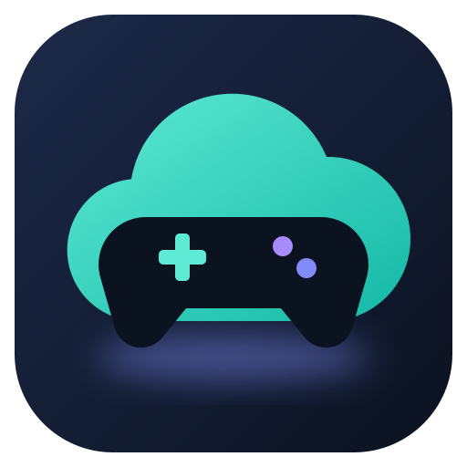
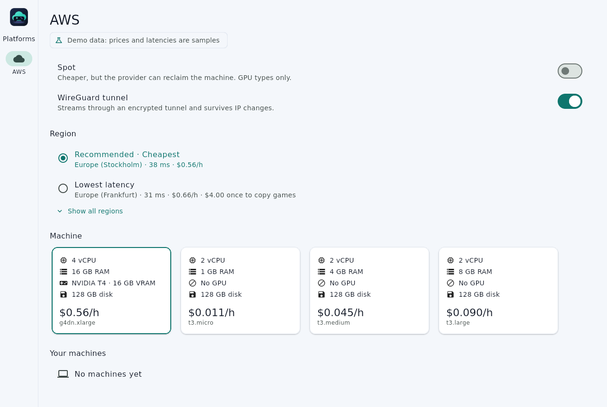
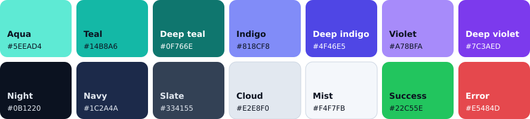

<p align="center">
  
</p>

<h1 align="center">ReGa</h1>

<p align="center">Play your games on a cloud machine you own, streamed to your Linux desktop.</p>

ReGa is a desktop app plus a set of Terraform and Ansible scripts. It sets up
a Windows gaming machine in your own cloud account (AWS first), streams it to
you with Moonlight and Sunshine, and stops it when you stop playing.



## Install

ReGa is an early preview, not yet tried on a real GPU machine. Each
[release](https://github.com/sergimn/ReGa/releases) has a Flatpak for x86_64
Linux. On Ubuntu:

```sh
sudo apt install flatpak
flatpak remote-add --user --if-not-exists flathub https://dl.flathub.org/repo/flathub.flatpakrepo
wget -O rega-x86_64.flatpak https://github.com/sergimn/ReGa/releases/latest/download/rega-x86_64.flatpak
flatpak install --user rega-x86_64.flatpak   # also pulls its runtime from Flathub
flatpak install --user flathub com.moonlight_stream.Moonlight   # to play
flatpak run io.github.sergimn.rega
```

The release notes say what your AWS account needs before you launch a
machine; without AWS credentials the app shows sample data.

## Repository

| Path | What |
| --- | --- |
| `app/` | Desktop app: Flutter UI on a Rust core, packaged as a Flatpak (see [app/flatpak/README.md](app/flatpak/README.md)). See [app/README.md](app/README.md). |
| `infra/` | Terraform and Ansible that create and configure the cloud machine. |
| `docs/releases/` | Release notes, one file per version. |

Checks, pinned versions and dependency updates: see [CONTRIBUTING.md](CONTRIBUTING.md).

## Colour palette

Cool tones only: teal for actions, indigo and violet for accents, on navy.
The values live in [`app/lib/theme.dart`](app/lib/theme.dart).



| Role | Light theme | Dark theme |
| --- | --- | --- |
| Primary | Deep teal `#0F766E` | Aqua `#5EEAD4` |
| Secondary | Deep indigo `#4F46E5` | Indigo `#818CF8` |
| Tertiary | Deep violet `#7C3AED` | Violet `#A78BFA` |
| Surface | Mist `#F4F7FB` | Night `#0B1220` |
| Cards | White | Navy `#1C2A4A` |
| Error | `#CE2C31` | `#F87171` |

## Licence

ReGa is released under the [MIT License](LICENSE). The vendored Cargokit
build scripts in `app/rust_builder/cargokit/` keep their own copyright and
licence, in [their LICENSE file](app/rust_builder/cargokit/LICENSE). The
Flatpak ships the notices of the Rust crates and standard library built into
the app, and Terraform's licence, in `/app/share/licenses/io.github.sergimn.rega/`
(see [app/flatpak/README.md](app/flatpak/README.md#rust-crate-licences)).
The AWS logo in the app is a trademark of Amazon.com, Inc. or its affiliates
and isn't under ReGa's licence; ReGa isn't affiliated with or endorsed by
AWS. Where it comes from is in
[app/assets/platforms/aws/README.md](app/assets/platforms/aws/README.md).
